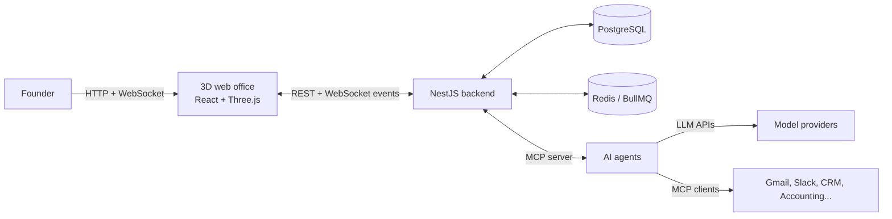

# AI Pet Company

A virtual company for solo founders. One founder hires a team of AI agents, gives each one a business role (CEO, Marketing, Sales, Finance, Operations, and so on), and watches them work together in a live visual office. The founder can talk to any agent, hand out work, and approve anything consequential before it happens.

> **Status:** early design. This README describes the planned architecture; the code is not written yet.

---

## Why

Solo founders cover every business function alone. AI agents can already do much of that work, but they live in separate chat windows with no shared view of who is doing what. Existing multi-agent tools are either text dashboards or visual offices built only for coding agents.

AI Pet Company gives a founder one place where their AI team is **visible, coordinated, and accountable**.

## Core features

- **Role-based agents.** Each agent has a role, a persona, instructions, memory, allowed tools, and a budget.
- **Live visual office.** Every agent appears as a character. It walks to its desk when it picks up a task, meets teammates to hand work over, and shows a bubble when it needs the founder.
- **Founder interaction.** Click any agent to chat with it, assign a task, or brief the CEO agent, which splits a goal into tasks for the team.
- **Approvals queue.** Outward actions such as sending email, publishing a post, or spending money wait for the founder to approve, reject, or turn into a standing rule.
- **Real tools.** Agents connect to real services (email, calendar, social media, CRM, accounting) through MCP, so every animation reflects real work.
- **Company memory and reports.** Shared knowledge, daily summaries, and a weekly founder report.

## Architecture

The system has three layers. The backend holds the truth; the office is only a renderer of that truth.



1. **Agents.** Each agent runs as a worker session: an LLM call loop with the agent's role prompt, memory, and tool permissions. Agents can be built in (run by the backend's agent runner) or external (any MCP-compatible agent that connects to the office).
2. **Backend (NestJS).** The coordination server: agent registry, task board, messages between agents, approvals, memory, and an event log. It is also exposed as an **MCP server**, so agents use tools like `claim_task`, `send_message`, `report_status`, and `request_approval`.
3. **Office frontend.** A 3D web app built with Three.js through React Three Fiber. It shows the office from a fixed isometric camera (zoom and pan allowed) with low-poly rigged characters. It subscribes to backend events over WebSockets and animates them: each event (task claimed, tool called, approval requested, task done) maps to a character action such as walking to a desk, typing, meeting, or showing a bubble.

## Tech stack

| Layer | Choice |
| --- | --- |
| Backend | [NestJS](https://nestjs.com/) (TypeScript) |
| Database | PostgreSQL with Prisma |
| Queue and jobs | Redis with BullMQ (agent runs, schedules, retries) |
| Realtime | NestJS WebSocket gateway (Socket.IO) |
| Agent protocol | Model Context Protocol (MCP), `@modelcontextprotocol/sdk` |
| LLMs | Pluggable providers (OpenAI, Anthropic, Gemini, xAI, local via Ollama) |
| Frontend | React and Vite, with Tailwind for the founder UI |
| 3D office | Three.js via React Three Fiber, `@react-three/drei` helpers, Zustand for office state |
| 3D assets | Low-poly GLB models; rigged characters with idle, walk, type, and talk animations (for example from Mixamo) |
| Pathfinding | Grid or navmesh pathfinding on the office floor (for example `three-pathfinding`) |
| Auth | JWT for the founder; per-agent API tokens for MCP access |
| Monorepo | pnpm workspaces with Turborepo |

## Backend modules (NestJS)

| Module | Responsibility |
| --- | --- |
| `AuthModule` | Founder login, agent tokens |
| `CompanyModule` | The company, its settings, and office layout |
| `AgentsModule` | Hire, configure, pause, and remove agents; roles and personas |
| `TasksModule` | Task board: create, assign, claim, update, complete |
| `MessagesModule` | Founder-to-agent and agent-to-agent conversations |
| `ApprovalsModule` | Pending actions, decisions, standing rules |
| `RunnerModule` | Runs built-in agents: LLM loop, tool calls, budget checks (BullMQ workers) |
| `ToolsModule` | Registry of MCP tool connections each agent may use |
| `MemoryModule` | Shared company memory and per-agent notes |
| `EventsModule` | Event log plus the WebSocket gateway that feeds the office |
| `McpModule` | Exposes the office itself as an MCP server for agents |
| `ReportsModule` | Daily summaries and weekly founder reports |

### Event flow example

1. The founder asks the CEO agent to "launch a promo next week."
2. The CEO agent creates tasks and assigns one to the Marketing agent (`task.created`, `task.assigned`).
3. The Marketing agent claims the task (`task.claimed`); in the office, its character walks to its desk.
4. It drafts a post and asks to publish (`approval.requested`); a bubble appears over its head.
5. The founder approves (`approval.granted`); the agent publishes and completes the task (`task.completed`).

## Planned project structure

```
aipetcompany/
├── apps/
│   ├── backend/          # NestJS API, WebSocket gateway, MCP server, agent runner
│   └── web/              # React + Three.js (React Three Fiber) office and founder UI
│       └── public/models # GLB characters, furniture, and office rooms
├── packages/
│   ├── shared/           # Shared types: events, DTOs, role definitions
│   └── agent-sdk/        # Helper for external agents to join the office over MCP
├── docker-compose.yml    # PostgreSQL + Redis for local development
└── README.md
```

## Getting started (planned)

Requirements: Node.js 20+, pnpm, Docker.

```bash
pnpm install
docker compose up -d          # start PostgreSQL and Redis
cp apps/backend/.env.example apps/backend/.env
pnpm --filter backend prisma migrate dev
pnpm dev                      # runs backend and web together
```

The backend runs on `http://localhost:3000`, the MCP endpoint on `http://localhost:3000/mcp`, and the office on `http://localhost:5173`.

### Environment variables

| Variable | Purpose |
| --- | --- |
| `DATABASE_URL` | PostgreSQL connection string |
| `REDIS_URL` | Redis connection string |
| `JWT_SECRET` | Founder session signing key |
| `OPENAI_API_KEY`, `ANTHROPIC_API_KEY`, ... | Model provider keys (only the ones you use) |

## Roadmap

- [ ] **MVP:** NestJS backend with agents, tasks, messages, and events; a 3D isometric office showing agent states; founder chat with one agent
- [ ] Built-in agent runner with role templates (CEO, Marketing, Sales, Finance, Ops)
- [ ] Approvals queue and standing rules
- [ ] MCP server so external agents can join the office
- [ ] Real tool connections (email, social, accounting)
- [ ] Company memory, daily and weekly reports
- [ ] Mobile approvals and notifications
- [ ] Office editor: rearrange rooms and furniture, custom characters
- [ ] Desktop wallpaper mode for the office

## License

TBD
